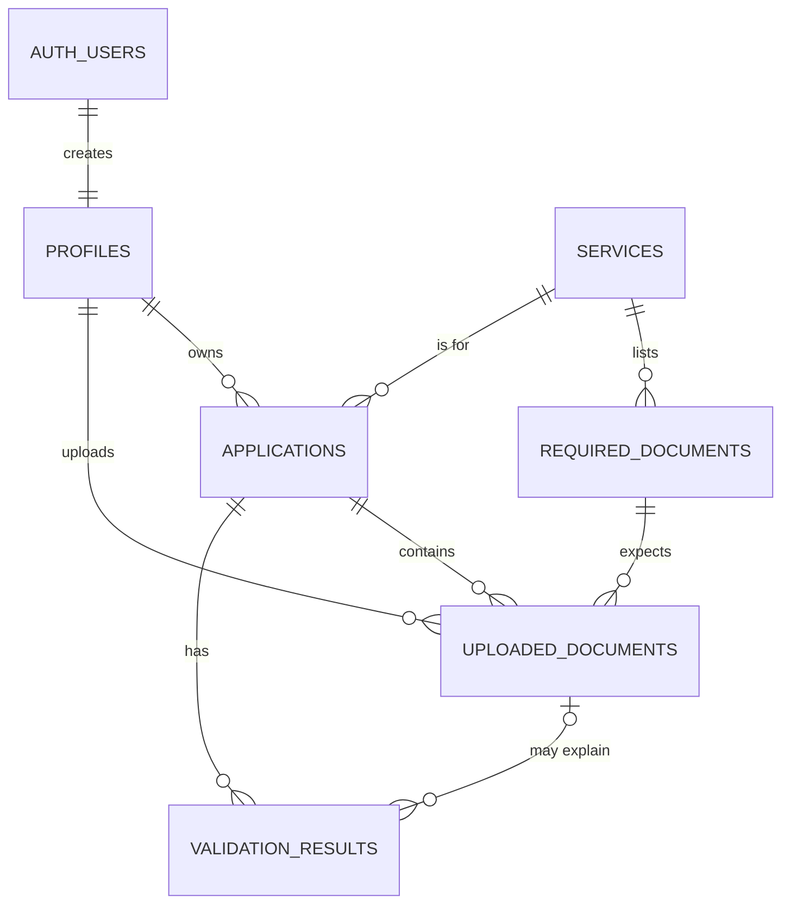

# Database design

This describes the SQL in `supabase/`. The project owner runs that SQL in the Supabase SQL Editor. The app does not connect to the database in this step.

## Tables

| Table | Purpose |
| --- | --- |
| profiles | One row per signed-in user. New users are citizens. |
| services | A government service, such as Community Certificate. |
| required_documents | The checklist items for one service. |
| applications | One citizen's draft check for one service. |
| uploaded_documents | The file attached to one checklist item. |
| validation_results | One pass, warning, or fail. A row with no uploaded document is a cross-document check. |

## Relationships



`AUTH_USERS` is Supabase Auth (`auth.users`). A profile is deleted when that auth user is deleted. Deleting an application deletes its uploads and check results.

## Storage path

Files go in the private bucket `documents`.

```text
{user_id}/{application_id}/{required_document_code}-{filename}
```

Example: `8f3c2a40-1111-4111-8111-111111111111/21ab9c10-2222-4222-8222-222222222222/applicant_photo-sample.jpg`

The first folder must equal the signed-in user's id. That is what the storage policies check.

## JSON used by a later step

`keywords` helps a later step recognise a document. Empty arrays mean "no keywords".

```json
{"en": ["address", "address proof"], "ta": ["முகவரி"]}
```

`required_fields` is a draft list of fields to read. The official source does not specify these fields. The photo row uses an empty list.

```json
["name", "date"]
```

`rules` holds image and matching hints. A later step (Step 8) will read them. Every key is optional.

| Key | Meaning |
| --- | --- |
| min_width | Smallest acceptable image width in pixels. |
| min_height | Smallest acceptable image height in pixels. |
| min_blur_score | Lowest sharpness score to accept. A higher number means sharper. |
| min_brightness | Lowest accepted brightness. |
| max_brightness | Highest accepted brightness. |
| id_number_pattern | Optional pattern for a masked number. The Community Certificate seed does not set one, because the official source does not specify a number format. |
| max_age_days | Oldest accepted document age. Null means no expiry rule is known. |
| check_name_match | When true, a later step compares the name on this file with the application. |
| fields_are_draft | Marks extraction fields as unverified against the portal. |
| discrepancy_unresolved | Marks the DNC row, which is on the Service List and not in FAQ Question 7. |

Photo rows use smaller minimum sizes and no OCR keywords.

## Privacy

- There is no column for a full Aadhaar number or other full ID number.
- OCR text is stored only in `ocr_text_masked`. Extracted details go in `extracted_fields` as JSON.
- The browser uses the Supabase anon key. Row-level security limits what that key can read.
- The backend will use the service-role key, which bypasses row-level security, to write check results.
- Admins can read application rows. They have no storage policy, so they cannot open the document files.
